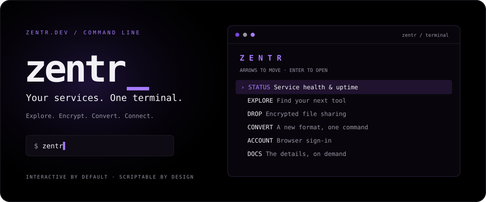

<div align="center">



**The zentr.dev toolkit, right where you work.**

[](https://github.com/zentrdev/zentr-cli/actions/workflows/check.yml)


[](https://github.com/zentrdev/zentr-cli/releases)

[**Get started**](#get-started) · [**The commands**](#the-commands) · [**Full guide**](docs/usage.md) · [**zentr.dev ↗**](https://zentr.dev)

</div>

---

## One command. Your whole toolkit.

```text
 _____  _____  _   _  _____  ____
|__  / | ____|| \ | ||_   _||  _ \
  / /  |  _|  |  \| |  | |  | |_) |
 / /_  | |___ | |\  |  | |  |  _ <
/____| |_____||_| \_|  |_|  |_| \_\

$ zentr
```

Open a black-and-purple terminal interface. Check service health, share encrypted
files, convert audio and images, or sign in with your Zentr account. Prefer a
one-liner? Every operation is also available through commands.

| | Inside Zentr |
| :--- | :--- |
| **⌘ Guided terminal** | Menus, ASCII branding, keyboard navigation, path completion, and prompts for missing inputs. |
| **↗ Live service health** | Registry discovery, latency, uptime, and service status from Zentr's public APIs. |
| **◇ Encrypted Drop** | The existing Drop CLI, bundled: files, text, downloads, status, and short links. |
| **⇄ File conversion** | Discover available formats and stream files through Zentr Convert. |
| **◎ One account** | Browser sign-in with PKCE and verified ID tokens; sessions stored through your OS keyring. |
| **› Script-friendly** | JSON output for Python commands, ordinary exit codes, and no prompts in pipes. |

## Get started

**Python 3.10+** is required. Install **Node.js 20.11+** to use Drop. A separate Drop
installation is not needed.

With [uv](https://docs.astral.sh/uv/):

```sh
uv tool install 'git+https://github.com/zentrdev/zentr-cli.git@v0.3.1'
zentr
```

Or with [pipx](https://pipx.pypa.io/):

```sh
pipx install 'git+https://github.com/zentrdev/zentr-cli.git@v0.3.1'
zentr
```

<details>
<summary><strong>Prefer a local checkout and virtual environment?</strong></summary>

```sh
git clone https://github.com/zentrdev/zentr-cli.git
cd zentr-cli
python3 -m venv .venv
source .venv/bin/activate
python -m pip install .
zentr
```

On Windows, activate with `.venv\Scripts\activate` instead.

</details>

> **GitHub only.** Install from this repository or a [release](https://github.com/zentrdev/zentr-cli/releases). This project is not published to PyPI.

## Interactive when you want it

```sh
zentr                         # Home screen
zentr drop                    # Sharing menu
zentr convert                 # Conversion menu
zentr auth                    # Account menu
zentr convert file voice.wav  # Ask for the missing format and output
```

**↑ ↓** navigate · **Enter** opens · **Esc** goes back · **Tab** switches controls
or completes paths · **Ctrl-C** dismisses a dialog

The full ASCII logo appears in terminals at least **55 × 28**; smaller windows use
a compact header. `NO_COLOR=1` selects monochrome. `zentr ui` and `zentr tui` open
the home screen explicitly.

### Direct when you need it

```sh
# Send a file. No menu, even with stdin closed.
zentr drop --upload "$HOME/report.html" </dev/null

# Pipe text straight into an encrypted share.
printf 'hello from my terminal' | zentr drop text

# Fetch machine-readable health data.
zentr --json status > status.json

# Convert a recording.
zentr convert file voice.wav --to audio-wav-mp3 -o voice.mp3
```

Fully specified commands run directly. With noninteractive input/output or
`TERM=dumb`, bare commands show the relevant help and missing arguments fail
without prompting. JSON never includes the banner or menus.

## The commands

| Command | What happens |
| :--- | :--- |
| `zentr` | Open the home interface, or print help outside a terminal |
| `zentr --login` | Sign in through your browser |
| `zentr whoami` | Show your signed-in profile |
| `zentr --logout` | Remove the local CLI session |
| `zentr services` | Browse services interactively; list them outside a terminal |
| `zentr status` | Explore service health interactively; print it outside a terminal |
| `zentr open tools` | Open a registered service in your browser |
| `zentr docs drop` | Open a project's documentation |
| `zentr drop upload photo.png notes.pdf` | Encrypt and upload files |
| `zentr drop text "hello"` | Create an encrypted text share |
| `zentr drop get 'https://drop.zentr.dev/f/CODE5#KEY' -o downloads` | Decrypt and download a direct Drop link |
| `zentr drop status CODE5` | Inspect a drop |
| `zentr drop shorten 'https://example.com'` | Create a short URL |
| `zentr convert formats` | List available conversion IDs |
| `zentr --help` | Show all top-level commands and options |

`--upload` is an alias for `upload`. Put global flags **before** the command:
`zentr --timeout 300 convert file photo.heic --to heic-jpeg -o photo.jpg`.

## A few things worth knowing

<details>
<summary><strong>◇ Drop: encryption, limits, and links</strong></summary>

- Files and text are encrypted locally with AES-256-GCM using the existing Drop protocol.
- Up to **20 files / 10 GiB** per upload, subject to service limits.
- The full share link, including `#KEY`, grants access. Keep it private and quote it in your shell.
- Downloads verify encrypted chunks and never overwrite existing files. Completed files remain if a later file fails.
- Upload links go to stdout; progress goes to stderr. Text downloads go to stdout.
- Shortening strips the fragment before the API request and reattaches it locally.
- CLI uploads are **anonymous and temporary**, even when you sign into Zentr. Permanent account storage is not implemented here.
- Drop requires Node.js. The global `--json` and `--timeout` options do not apply to its bundled commands.

</details>

<details>
<summary><strong>◎ Sign-in: your browser, your credential store</strong></summary>

Run `zentr --login`, sign into auth.zentr.dev, and approve **Zentr CLI**.
Keep localhost port **8787** free, and run your browser on the same computer.

Login uses one-time state, S256 PKCE, nonce checks, and ES256 signature/issuer/audience/expiry
validation. Sessions are saved through Python keyring; there is no built-in plaintext
fallback. Windows and Linux need a working keyring backend. Sessions currently last
about 15 minutes; sign in again when prompted. Logout removes the local CLI session,
not your browser session or an already-issued token.

For automation, `ZENTR_ACCESS_TOKEN` can supply an existing userinfo access token.
It overrides the stored session and is not cleared by logout.

</details>

<details>
<summary><strong>⇄ Conversion: what leaves your computer</strong></summary>

Conversion uploads your file to the Zentr Convert server. It is not local processing.
Choose an ID from `zentr convert formats`. Output files must be new; failed transfers
remove their partial output. Server limits and rate limits still apply.

</details>

<details>
<summary><strong>› Automation: streams, exit codes, and shell quoting</strong></summary>

Python commands support `--json`. Exit codes: **0** success, **1** service/runtime
failure or a down status, **2** argument errors, **130** interrupted Python operations.
Drop preserves its original exit behavior. Status reflects the public monitor's
observations and timestamps, rather than new probes made by the CLI.

When using `zsh -c`, quote the entire command:

```sh
zsh -c 'zentr drop --upload "$HOME/report.html"' </dev/null
```

`$HOME` already contains your home-directory path.

</details>

## Build something with it

```sh
python -m pip install -e . pytest build
python -m pytest tests -q
node --test tests/drop.test.mjs
python -m build
```

The test suite covers command dispatch, interactive fallbacks, OAuth callbacks and
token validation, conversion transfers, and Drop cryptography. CI tests and builds
the package; it does **not** publish to PyPI. Live service smoke checks are separate
from CI and use disposable samples.

Explore the [full usage guide](docs/usage.md), [open an issue](https://github.com/zentrdev/zentr-cli/issues),
or browse the [Zentr services](https://zentr.dev).

---

<div align="center">

**Less clicking. More doing.**

[**zentr.dev**](https://zentr.dev) · [Documentation](https://docs.zentr.dev) · [Releases](https://github.com/zentrdev/zentr-cli/releases)

</div>
